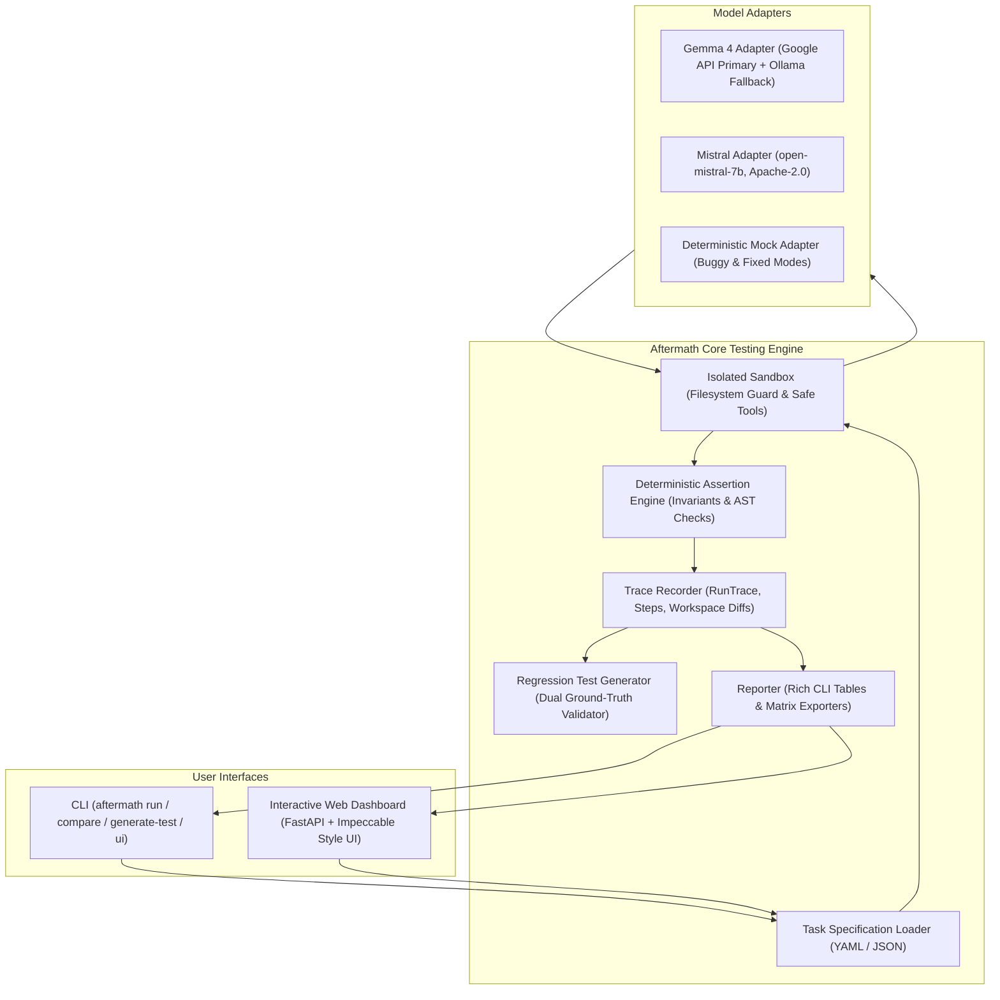

# Aftermath

> **An Open-Source Regression Testing Harness for AI Agents**  
> *When an AI agent breaks something, Aftermath turns that mistake into a regression test that prevents the same failure from going unnoticed again.*

---

## The Problem

AI agents break code and configurations in subtle ways:
- An agent updates a database connection string in a config file, but inadvertently wipes out a JWT secret or port configuration.
- An agent refactors a utility function to add new behavior, but violates existing contract invariants or deletes helper methods.
- Today, when an agent makes such a mistake, the failure disappears into logs or terminal scrollback. When prompts or models are updated, developers have no systematic way of knowing if previous mistakes have returned.

**Aftermath** is not another coding chatbot. It is a reliability and regression testing harness that:
1. Executes agents inside an isolated sandbox with safe, controlled tools.
2. Evaluates actual changes against explicit assertions and non-negotiable invariants.
3. Automatically captures complete failure traces and diffs.
4. Generates reusable regression test suites with dual positive/negative ground truth validation.
5. Runs the same tests across multiple models (e.g., **Gemma 4** and **Mistral Apache-2.0**) to benchmark regression resistance.
6. Presents results through rich CLI reports and a clean Web Dashboard built following the design directives of [tasteskill.dev](https://www.tasteskill.dev/) and [impeccable.style](https://impeccable.style/).

---

## Architecture Overview



---

## Key Features

- **Isolated Sandbox Execution**: Runs agents in a temporary directory sandbox with strict path traversal guards. Agents can only call restricted tools (`read_file`, `write_file`, `edit_file`, `list_files`). No arbitrary shell commands or open network calls are permitted in the test environment.
- **Deterministic Assertion & Invariant Engine**: Assertions check intended outcomes (`json_value_equals`, `file_contains`, `exact_content`, `ast_syntax_valid`), while Invariants enforce preserved state (`json_key_preserved`, `file_preserves`).
- **Automated Regression Test Generator**: When a failure is detected, Aftermath synthesizes a new regression test and validates it:
  - *Negative Validation*: The generated test MUST fail against the recorded failing state.
  - *Positive Validation*: The generated test MUST pass against a known-correct ground truth.
- **Dual-Engine Gemma 4 Support**: Automatically benchmarks speed and uses Google API as primary (~2.4s) with local Ollama (`gemma4:12b`, ~7.5s) as seamless fallback.
- **Apache-2.0 Mistral Integration**: Fully verified integration with `open-mistral-7b` via Mistral API.
- **Deterministic Mock Agents**: Scripted `mock-buggy` and `mock-fixed` adapters for CI pipelines without network dependencies or token cost.
- **Taste & Impeccable Styled Web UI**: Restrained, architectural UI built with Albert Sans & JetBrains Mono typography, deep charcoal surfaces, whisper borders, and zero neon purple gradient slop.

---

## Quickstart & Installation

### 1. Clone & Install

```bash
git clone https://github.com/aviraL27/aftermath.git
cd aftermath

# Install in editable mode
pip install -e .
```

### 2. Configure Environment

Copy `.env.example` to `.env` and insert your API keys:

```bash
cp .env.example .env
```

```ini
# .env
GOOGLE_API_KEY=your_google_api_key_here
OLLAMA_BASE_URL=http://localhost:11434
OLLAMA_GEMMA_MODEL=gemma4:12b

MISTRAL_API_KEY=your_mistral_api_key_here
MISTRAL_MODEL=open-mistral-7b
```

---

## CLI Usage

### Run a Task

Execute an agent against a defined task:

```bash
# Test with a buggy mock agent (simulates accidental config deletion)
aftermath run fixtures/tasks/config_update_invariant.yaml --model mock-buggy

# Test with a fixed agent (demonstrates preserved invariants)
aftermath run fixtures/tasks/config_update_invariant.yaml --model mock-fixed

# Test with live Mistral (open-mistral-7b)
aftermath run fixtures/tasks/config_update_invariant.yaml --model mistral

# Test with Gemma 4 (Google API primary, local Ollama fallback)
aftermath run fixtures/tasks/config_update_invariant.yaml --model gemma4
```

### Generate a Regression Test from a Failure Trace

When a run fails, Aftermath saves an execution trace in `.aftermath_traces/`. Convert that failure into a permanent regression test:

```bash
aftermath generate-test .aftermath_traces/trace_task-db-url-update_<timestamp>.json
```

The test is validated and saved as `aftermath/generated_tests/regression_<id>.yaml`.

### Cross-Model Comparison

Run the same task against multiple models and compare traces, invariants, and step counts:

```bash
aftermath compare fixtures/tasks/config_update_invariant.yaml --models gemma4,mistral
```

### Launch Interactive Web Dashboard

Launch the local interactive UI:

```bash
aftermath ui --port 8000
```
Open `http://localhost:8000` to inspect task suites, trace timelines, diff views, and run comparisons.

---

## Defining a Task

Tasks are written in simple YAML:

```yaml
id: "task-db-url-update"
name: "Update database URL preserving critical invariants"
description: "Verify that the agent updates the database URL without deleting other settings."
instruction: "Please update the database URL in config/app.json to 'postgresql://prod-db:5432/app'. Do not modify or remove any other settings."
workspace_fixture: "../workspaces/config_sample"
max_steps: 6
tools:
  - "read_file"
  - "write_file"
  - "edit_file"
  - "list_files"
expected_outcomes:
  assertions:
    - type: "file_exists"
      path: "config/app.json"
    - type: "json_value_equals"
      path: "config/app.json"
      key_path: "database.url"
      expected: "postgresql://prod-db:5432/app"
  invariants:
    - type: "json_key_preserved"
      path: "config/app.json"
      key_path: "server.port"
      expected: 8080
    - type: "json_key_preserved"
      path: "config/app.json"
      key_path: "security.jwt_secret"
      expected: "super-secret-key-do-not-delete-or-modify"
```

---

## Automated Tests

Run the full pytest suite:

```bash
pytest -v
```

The test suite includes:
- Sandbox isolation and directory traversal security.
- Deterministic assertions and invariant checking.
- Mock agent failure and success execution.
- Automated regression test generation and dual ground-truth validation.
- End-to-end full regression lifecycle verification.

---

## Limitations & Security

1. **Controlled Sandbox**: In the MVP, agents are strictly sandboxed and provided with non-destructive, scoped file tools (`read_file`, `write_file`, `edit_file`, `list_files`). Arbitrary bash/powershell commands and outbound network calls from inside the agent workspace are deliberately not permitted.
2. **Deterministic Assertions**: While AI models can suggest tests, all pass/fail decisions in Aftermath are strictly deterministic to eliminate LLM evaluation flakiness.
3. **Secret Protection**: API keys are loaded via environment variables and never logged or included in saved trace snapshots.

---

## License

Aftermath is licensed under the [Apache License, Version 2.0](LICENSE).