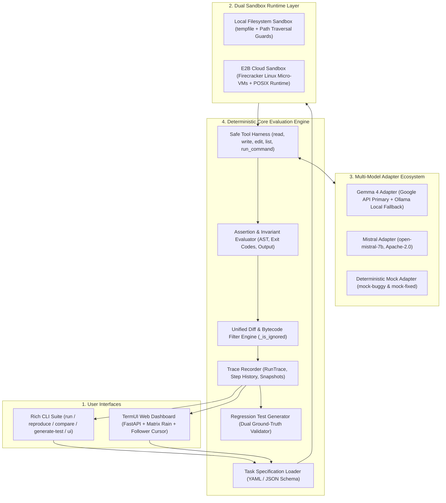
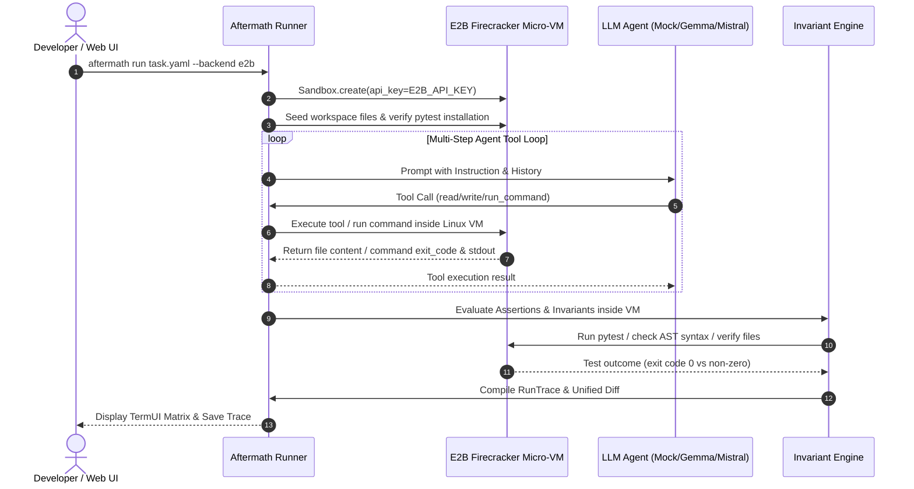
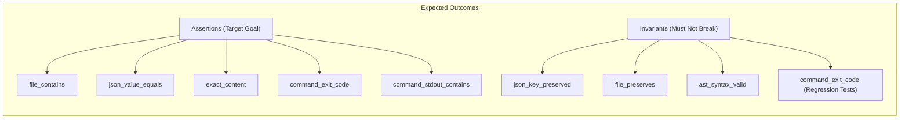
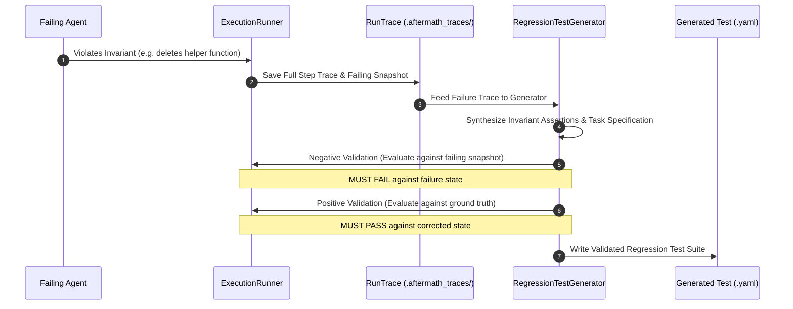

# Aftermath

> **An Open-Source Regression Testing Harness for AI Agents**  
> *When an AI agent breaks something, Aftermath turns that mistake into an automated, validated regression test that prevents the same failure from going unnoticed again.*

**Live Deployment (Render):** [https://aftermath-1494.onrender.com](https://aftermath-1494.onrender.com)  
**Static UI Mirror:** [https://aftermath-ui.onrender.com](https://aftermath-ui.onrender.com)

---

## The Problem

AI coding agents break software in subtle, catastrophic ways:
- **Collateral Deletion**: An agent updates a database connection string in a config file, but accidentally deletes a JWT secret or port configuration.
- **Contract Violations**: An agent refactors a utility function to add new behavior, but violates existing function signatures or deletes critical helper methods.
- **Silent Regressions**: Unlike human engineers who rely on established CI test suites, agent mistakes often disappear into terminal scrollback or logs. When model weights, system prompts, or tool schemas update, developers have no systematic way of knowing if previously solved failures have resurfaced.

**Aftermath** is not another coding chatbot or prompt playground. It is an industrial-grade reliability and regression testing harness designed specifically for autonomous AI agents.

---

## System Architecture

Aftermath separates agent interaction, execution sandboxing, deterministic invariant evaluation, and test synthesis into modular, decoupled layers:



---

## Detailed Architectural Components

### 1. Dual Sandbox Runtime Layer

Aftermath supports two execution backends selectable via configuration or `--backend [local|e2b]`:

#### A. E2B Cloud Sandbox (Firecracker Linux Micro-VM)
- **Engine**: Powered by `e2b>=1.0.0` and hardware-isolated Firecracker micro-VMs.
- **Security & Isolation**: Agent code and shell executions run entirely in a secure remote Linux VM, protecting host workstations from unconstrained agent code.
- **Live Test Execution**: Supports arbitrary command execution via `sb.run_command(cmd)`. Common test utilities (`pytest`, `python -m unittest`, build scripts) run directly in POSIX Linux micro-VM environments.
- **Automated Provisioning**: Workspace fixtures are uploaded to `/home/user/workspace`, missing runtime packages (e.g., `pytest`) are verified and auto-installed on boot, and non-zero exit codes are safely captured without crashing runner pipelines.
- **Fast Lifecycle**: Micro-VMs initialize in sub-seconds and are terminated immediately upon completion of the test run.



#### B. Local Filesystem Sandbox
- **Engine**: Ephemeral temporary directories created via Python's `tempfile.TemporaryDirectory`.
- **Security Guardrails**: Every file operation (`read_file`, `write_file`, `edit_file`, `list_files`) resolves paths through `_resolve_safe(path)`. Paths attempting directory traversal (`../` escaping the sandbox root) trigger an immediate `SecurityViolationError`.
- **Cross-Platform Compatibility**: Automatically translates POSIX commands (such as `python3`) to platform-specific executables on Windows environments.

---

### 2. Deterministic Assertion & Invariant Engine

Pass/fail decisions in Aftermath are strictly deterministic to eliminate LLM evaluation flakiness.



- **Target Assertions**: Verify that the agent accomplished the primary requested change (e.g., `verify_api_key` added, or new database URL configured).
- **Non-Negotiable Invariants**: Guarantee that preexisting functionality was not destroyed (e.g., existing unit tests still exit with code `0`, AST remains parseable Python syntax, existing JSON keys remain intact).
- **AST Syntax Checking**: Parses modified Python files via `ast.parse()` to catch broken syntax trees before files ever reach execution.
- **Clean Diff Engine**: Filters out Python bytecode (`__pycache__`, `.pyc`, `.pytest_cache`) to ensure diffs and snapshots represent pure source code modifications.

---

### 3. Automated Regression Test Generator (Dual Ground-Truth Validation)

When an agent violates an invariant, Aftermath does not just log an error—it synthesizes a permanent, reproducible regression test suite:



---

### 4. Multi-Model Adapter Ecosystem

- **Gemma 4**: Built-in speed benchmarking. Prioritizes the ultra-fast Google API (~2.4s) and automatically falls back to local Ollama (`gemma4:12b`, ~7.5s) if offline.
- **Mistral**: Verified integration with `open-mistral-7b` (Apache-2.0).
- **Deterministic Mock Adapter**: Scriptable `mock-buggy` and `mock-fixed` agents for zero-token, sub-second testing in CI/CD pipelines.

---

### 5. TermUI Web Dashboard

The web dashboard is styled to strictly match **[TermUI](https://www.termui.io/)**:
- **Custom Follower Cursor**: Green glowing hover circle (`#00ff88`) with spring easing that smoothly expands and highlights interactive elements. Native OS cursor is hidden.
- **Matrix Rain Canvas**: Real-time digital rain stream rendering Katakana and hex glyphs in the background.
- **CRT Scanlines & Aurora Glow**: Hardware-accelerated terminal scanlines and subtle radial glow.
- **Terminal Chrome & Crosshairs**: macOS-style window dots, bento grid cards, corner crosshairs, and live micro-VM output panels.

---

## Directory Structure

```
aftermath/
├── aftermath/
│   ├── adapters/          # LLM integrations (Gemma, Mistral, Mock)
│   ├── core/
│   │   ├── assertions.py  # Deterministic assertion & invariant evaluators
│   │   ├── generator.py   # Automated regression test synthesizer
│   │   ├── reporter.py    # Rich CLI tables & comparison formatters
│   │   ├── runner.py      # Agent execution loop & step recorder
│   │   ├── sandbox.py     # Local tempfile & E2B micro-VM runtime
│   │   ├── task.py        # Pydantic schemas for tasks & invariants
│   │   └── trace.py       # Execution trace data structures
│   ├── ui/
│   │   ├── server.py      # FastAPI backend
│   │   └── static/        # TermUI CSS, Canvas matrix rain, Client app
│   ├── cli.py             # Typer CLI application
│   └── config.py          # Environment settings (E2B, Google, Mistral)
├── fixtures/
│   ├── tasks/             # Standard task definitions & E2B regression suites
│   └── workspaces/        # Sample codebases (Auth services, Calculators, Configs)
├── tests/                 # 16 unit & integration test suites
├── pyproject.toml         # Dependencies (fastapi, typer, rich, e2b, pytest)
└── README.md
```

---

## Quickstart & Installation

### 1. Installation

```bash
git clone https://github.com/aviraL27/aftermath.git
cd aftermath

# Install dependencies in editable mode
pip install -e .
```

### 2. Configure Environment

Copy `.env.example` to `.env` and set your credentials:

```bash
cp .env.example .env
```

```ini
# E2B Sandbox API Key (Firecracker Micro-VM Runtime)
E2B_API_KEY=your_e2b_api_key_here

# Google API Key (Gemma 4 Cloud)
GOOGLE_API_KEY=your_google_api_key_here

# Local Ollama Fallback (Optional)
OLLAMA_BASE_URL=http://localhost:11434
OLLAMA_GEMMA_MODEL=gemma4:12b

# Mistral API Key (open-mistral-7b)
MISTRAL_API_KEY=your_mistral_api_key_here
MISTRAL_MODEL=open-mistral-7b
```

---

## Usage Guide

### 1. Launch the TermUI Web Dashboard

```bash
python -m aftermath.cli ui --port 8000
```
Open **[http://localhost:8000](http://localhost:8000)** in your browser:
- Click **Live E2B Demo** to spin up an E2B micro-VM, run the agent, and stream live `pytest` test results.
- Click **Compare Models** to benchmark `mock-buggy` vs `mock-fixed` across isolated micro-VMs.
- Click **Generate Regression Test** to synthesize a test suite from any invariant violation.

---

### 2. Command Line Interface (CLI)

#### Execute a Task in an E2B Micro-VM
```bash
# Run fixed agent in E2B (Passes test suite)
python -m aftermath.cli run fixtures/tasks/e2b_service_regression_test.yaml --model mock-fixed --backend e2b

# Run buggy agent in E2B (Catches invariant violation)
python -m aftermath.cli run fixtures/tasks/e2b_service_regression_test.yaml --model mock-buggy --backend e2b
```

#### Reproduce a Recorded Failure
```bash
python -m aftermath.cli reproduce .aftermath_traces/trace_e2b-auth-service-regression_<trace_id>.json
```

#### Compare Models Side-by-Side
```bash
python -m aftermath.cli compare fixtures/tasks/e2b_service_regression_test.yaml --models mock-buggy,mock-fixed --backend e2b
```

#### Generate a Regression Test from a Failure Trace
```bash
python -m aftermath.cli generate-test .aftermath_traces/trace_task-add-power-function_<trace_id>.json
```

---

## Defining a Task Specification

Tasks are declared in structured YAML:

```yaml
id: e2b-auth-service-regression
name: E2B Cloud Sandbox - Auth Service Regression Test
description: Evaluates an agent modifying an authentication service inside a secure E2B Linux Micro-VM.
instruction: "In auth.py, add a function 'def verify_api_key(key: str) -> bool:' that returns True if key begins with 'ak_live_' and False otherwise. Do not modify or remove existing token validation or role permission functions."
workspace_fixture: ../workspaces/e2b_service_sample
sandbox_backend: e2b
tools:
  - read_file
  - write_file
  - edit_file
  - list_files
  - run_command
max_steps: 10
expected_outcomes:
  assertions:
    - type: file_contains
      path: auth.py
      expected: "def verify_api_key(key: str) -> bool:"
      description: "verify_api_key function defined in auth.py"
    - type: command_exit_code
      command: "pytest test_auth.py"
      expected: 0
      description: "Full test suite passes via pytest in E2B micro-VM"
  invariants:
    - type: command_exit_code
      command: "pytest test_auth.py -k test_token_validation_live"
      expected: 0
      description: "Existing token validation invariant preserved"
    - type: ast_syntax_valid
      path: auth.py
      description: "auth.py remains valid Python syntax"
```

---

## Automated Verification

Run the full automated test suite (16 tests covering sandboxing, E2B commands, generator, and model adapters):

```bash
pytest -v
```

---

## License

Aftermath is open-source software licensed under the [Apache License, Version 2.0](LICENSE).